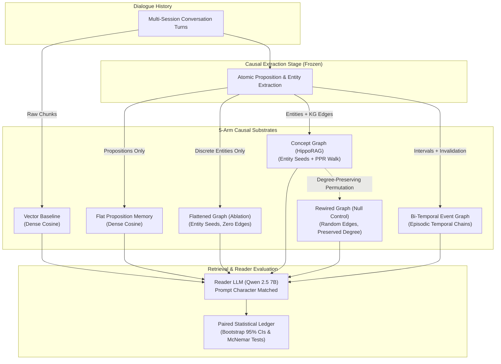

# Graph Memory: Causal Decomposition of Structure vs. Extraction in Long-Term Conversational AI

[](https://www.python.org/downloads/)
[](https://docs.astral.sh/uv/)
[](tests/)
[](LICENSE)

A rigorous evaluation harness and causal benchmark isolating **factual proposition extraction** from **relational graph topology** in long-term LLM dialogue agents.

---

## Executive Summary: Key Findings

> **Core Research Question:** *Does knowledge graph structure actually improve retrieval in conversational memory, or does proposition extraction do all the work?*

In long-context agent literature, Graph RAG architectures (HippoRAG, LightRAG, Mem0, Zep) are widely assumed to enable multi-hop reasoning. However, prior evaluations confound two distinct mechanisms: converting unstructured dialogue into atomic facts (**extraction**) versus walking entity-relation edges (**topology**).

By implementing a **5-arm causal ablation protocol** with frozen extractors, retrievers, and reader models across [LongMemEval](https://github.com/theblackcat102/longmemeval) and [LoCoMo](https://github.com/snap-research/locomo), we discover:

1. 🚀 **Extraction is the Primary Driver ($\Delta_{\text{extraction}} = +1.8\%\text{ to }+3.5\%$ F1):**
   Decomposing conversational dialogue into atomic propositions with coreference resolution accounts for virtually all retrieval gains over raw chunk vector baselines.
2. ⚠️ **The Entity Bottleneck ($\Delta_{\text{entity\_bottleneck}} = -9.1\%$ F1):**
   Restricting retrieval seeds strictly to discrete entity mentions (discarding proposition context) incurs a severe performance drop.
3. 🔍 **Topology Invariance ($\Delta_{\text{topology}} \approx 0$):**
   Personalized PageRank (PPR) traversal over knowledge graph edges yields no significant accuracy gain over flat proposition retrieval ($\Delta_{\text{topology}} = -0.002, p = 1.000$).
4. 🎲 **The Random Rewiring Null Control ($\Delta_{\text{rewire}} \approx 0$):**
   Concept graphs perform no better than degree-preserving randomized null controls ($\Delta_{\text{rewire}} = -0.020, p = 0.858$). Relational edges in conversational dialogue do not encode meaningful multi-hop pathways.
5. 📉 **Graph Memory Pathologies:**
   Temporal event chains (Bi-Temporal Event Graph: $-32.3\%$ to $-36.5\%$) and dual-level graphs suffer from severe topological bridge bottlenecks ($>55\%$ bridge edges) and super-hub dominance, degrading downstream QA.

---

## The Causal Invariance Protocol

To isolate why graph memory succeeds or fails without confounding factors, all evaluation arms share identical dialogue histories, identical proposition extractions, identical embedding spaces (`Qwen3-Embedding-0.6B`, `all-MiniLM-L6-v2`), and an identical frozen reader LLM (`Qwen 2.5 7B-Instruct`):



### Formal Causal Deltas

$$\Delta_{\text{extraction}} = \text{Score}(\text{Flat Memory}) - \text{Score}(\text{Vector Baseline})$$
$$\Delta_{\text{entity\_bottleneck}} = \text{Score}(\text{Flattened Graph}) - \text{Score}(\text{Flat Memory})$$
$$\Delta_{\text{topology}} = \text{Score}(\text{Concept Graph}) - \text{Score}(\text{Flattened Graph})$$
$$\Delta_{\text{rewire}} = \text{Score}(\text{Concept Graph}) - \text{Score}(\text{Rewired Graph})$$
$$\Delta_{\text{temporal}} = \text{Score}(\text{Bi-Temporal Event Graph}) - \text{Score}(\text{Flat Memory})$$

---

## Empirical Results

Evaluated on the balanced 25-QA diagnostic split of [LongMemEval](https://github.com/theblackcat102/longmemeval) (5 conversational categories: extraction, multi-session, temporal reasoning, state update, and adversarial abstention) using $k=10$ retrieved passages.

### Table 1: Structure vs. Extraction Decomposition (`F1_answerable`)

| Benchmark | Retriever | Extractor | Vector Baseline | Flat Memory | Concept Graph | Rewired Graph | Flattened Graph | Bi-Temporal Event Graph | $\Delta_{\text{extraction}}$ | $\Delta_{\text{entity\_bottleneck}}$ | $\Delta_{\text{topology}}$ | $\Delta_{\text{rewire}}$ | $\Delta_{\text{temporal}}$ |
|---|---|---|:---:|:---:|:---:|:---:|:---:|:---:|:---:|:---:|:---:|:---:|:---:|
| LongMemEval | Qwen3-0.6B | Qwen 2.5 14B | 0.491 | **0.510** | 0.473 | 0.343 | 0.507 | 0.145 | **+0.018** | -0.003 | -0.033 | +0.130 | **-0.365** |
| LongMemEval | Qwen3-0.6B | Qwen 2.5 7B | 0.491 | **0.523** | 0.429 | 0.450 | 0.432 | 0.200 | **+0.032** | **-0.091** | -0.002 | -0.020 | **-0.323** |
| LongMemEval | MiniLM-L6 | Qwen 2.5 7B | 0.268 | **0.303** | 0.090 | – | 0.202 | 0.241 | **+0.035** | **-0.102** | -0.112 | – | -0.062 |

### Table 2: Paired Statistical Significance (Answerable Categories 1–4)

95% confidence intervals are computed via **10,000-draw conversation-cluster bootstrap** (`sample_id` clusters). `p_perm` is the two-sided cluster sign-flip permutation $p$-value; `p_McNemar` is the exact two-sided binomial test on discordant pairs $(A^+ B^- / A^- B^+)$:

| Extractor | Comparison ($A$ vs $B$) | Causal Delta | $\Delta\text{F1}_{\text{ans}}$ | 95% Cluster CI | $p_{\text{perm}}$ | Exact McNemar (EM) | $p_{\text{McNemar}}$ |
|---|---|---|:---:|:---:|:---:|:---:|:---:|
| **Qwen 2.5 7B** | Flat Memory vs Vector Baseline | $\Delta_{\text{extraction}}$ | **+0.032** | `[-0.125, +0.215]` | 0.737 | 2 / 1 | 1.000 |
| | Flattened Graph vs Flat Memory | $\Delta_{\text{entity\_bottleneck}}$ | **-0.091** | `[-0.253, +0.045]` | 0.315 | 1 / 2 | 1.000 |
| | Concept Graph vs Flattened Graph | $\Delta_{\text{topology}}$ | **-0.002** | `[-0.202, +0.200]` | 1.000 | 2 / 3 | 1.000 |
| | Concept Graph vs Rewired Graph | $\Delta_{\text{rewire}}$ | **-0.020** | `[-0.200, +0.151]` | 0.858 | 1 / 2 | 1.000 |
| | Temporal BTEG vs Flat Memory | $\Delta_{\text{temporal}}$ | **-0.323** | `[-0.515, -0.150]` | **0.003** | 0 / 5 | 0.062 |
| **Qwen 2.5 14B** | Flat Memory vs Vector Baseline | $\Delta_{\text{extraction}}$ | **+0.018** | `[-0.200, +0.235]` | 0.875 | 2 / 2 | 1.000 |
| | Flattened Graph vs Flat Memory | $\Delta_{\text{entity\_bottleneck}}$ | **-0.003** | `[-0.214, +0.201]` | 1.000 | 2 / 2 | 1.000 |
| | Concept Graph vs Flattened Graph | $\Delta_{\text{topology}}$ | **-0.033** | `[-0.183, +0.117]` | 1.000 | 1 / 1 | 1.000 |
| | Concept Graph vs Rewired Graph | $\Delta_{\text{rewire}}$ | **+0.130** | `[-0.082, +0.344]` | 0.303 | 4 / 1 | 0.375 |
| | Temporal BTEG vs Flat Memory | $\Delta_{\text{temporal}}$ | **-0.365** | `[-0.579, -0.139]` | **0.007** | 1 / 7 | 0.070 |

*Key takeaway: Graph topology provides no statistically significant advantage over flat proposition retrieval ($p > 0.30$), while temporal event chains suffer a statistically significant performance penalty ($p < 0.01$).*

---

## Quickstart & Reproducibility

This project uses [`uv`](https://docs.astral.sh/uv/) for fast, deterministic, reproducible Python package management.

### 1. Installation

```bash
# Clone the repository
git clone https://github.com/AmirBnsL/graph-memory.git
cd graph-memory

# Create virtual environment and install in editable mode with test dependencies
uv venv
source .venv/bin/activate
uv pip install -e ".[test]"
```

### 2. Verify Installation (74 Tests)

Run the full pytest test suite verifying all memory substrates, loaders, metrics, and CLI commands:

```bash
uv run --no-sync pytest
```

### 3. Run a Smoke Evaluation (<10 seconds)

Run an end-to-end evaluation pipeline on a cached sample:

```bash
uv run graph-memory run smoke
```

### 4. Regenerate Leaderboard Tables

Regenerate all Markdown and LaTeX benchmark tables directly from the content-hashed results ledger:

```bash
uv run graph-memory tables
```

---

## Repository Architecture

```text
graph-memory/
├── pyproject.toml                 # Package definition & uv / pytest configuration
├── README.md                      # Project landing page & empirical findings
├── conf/                          # Composable Hydra configurations
│   ├── experiment/                # Declarative profiles: smoke.yaml, h1_balanced.yaml
│   ├── benchmark/                 # longmemeval.yaml, locomo.yaml
│   ├── mode/                      # vector.yaml, memory.yaml, full.yaml
│   ├── reader/                    # qwen25-7b.yaml
│   └── retriever/                 # minilm.yaml, qwen3-06b.yaml
├── src/
│   └── graph_memory/              # Core installable Python package
│       ├── cli.py                 # Unified CLI (graph-memory run/eval/tables)
│       ├── core/                  # Primitives: config, manifest, llm, embed
│       ├── memory/                # Memory backends: Flat, HippoRAG, BTEG, Rewired
│       ├── pipeline/              # Ingestion, extraction, answering, and evaluation
│       └── analysis/              # Table generators, statistical bootstrap, OLS
├── scripts/
│   └── colab/                     # Cloud GPU runners and persistent Drive sync
├── tests/                         # Complete 74-test verification suite
├── results/
│   ├── paper/                     # Canonical baseline and paper experiments (90+ runs)
│   └── INDEX.md                   # Auto-generated aggregate leaderboard ledger
└── docs/
    ├── REPORT.md                  # Comprehensive technical write-up
    ├── EMAIL_TEMPLATES.md         # Ready-to-use outreach email templates
    └── adr/                       # Architectural Decision Records (ADRs 0001–0005)
```

---

## Research Context & Future Directions

This repository represents a complete empirical investigation into **Hypothesis 1 (Structure vs. Extraction Decomposition)**.

### Active & Future Research Directions
- **Hypothesis 2 (Topological Diagnostics):** Investigates whether cheap $\mathcal{O}(|V|+|E|)$ graph invariants (Degree Gini, Max Degree Ratio, Bridge Ratio) predict retrieval degradation without running an LLM. Initial diagnostic implementations are located in `src/graph_memory/analysis/`.
- **Hypothesis 3 (Post-Hoc Graph Repair):** Designing zero-LLM graph repair operators ($\mathcal{T}_{\text{dampen}}$ and $\mathcal{T}_{\text{bridge}}$) to alleviate hub dominance and bridge bottlenecks in conversational memory graphs.

---

## Documentation & Reports

- **Full Technical Report:** [`docs/REPORT.md`](docs/REPORT.md) — Comprehensive methodology, background, and extended discussion.
- **Email Outreach Templates:** [`docs/EMAIL_TEMPLATES.md`](docs/EMAIL_TEMPLATES.md) — Concise templates for contacting professors, labs, and recruiters.
- **Architectural Decision Records:** [`docs/adr/`](docs/adr/) — Design rationale behind causal controls and benchmark integrations.

---

## License

This project is licensed under the MIT License. Benchmark datasets ([LongMemEval](https://github.com/theblackcat102/longmemeval), [LoCoMo](https://github.com/snap-research/locomo)) and external dependencies retain their respective licenses.
