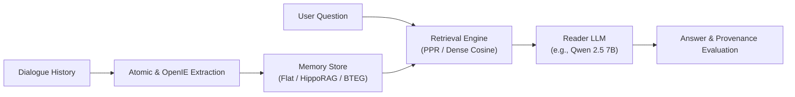

# Graph Memory: Bi-Temporal Graph Memory for Long-Term Conversations

[](https://www.python.org/downloads/)
[](https://docs.astral.sh/uv/)
[](LICENSE)

Rigorous evaluation harness and neurobiologically inspired graph memory engine for long-term LLM dialogue agents.

---

## Overview

Conversational agents interacting over long horizons need reliable episodic and semantic memory. **Graph Memory** evaluates and investigates:
1. **H1 — Structure vs. Extraction Decomposition:** Does topological graph structure provide retrieval power beyond the raw factual extraction of an LLM? Evaluated across naive dense retrieval, flat atomic facts, HippoRAG concept graphs, and Bi-Temporal Event Graphs (BTEG).
2. **H2 — Predictive Non-Parametric Topological Diagnostics:** Do cheap $\mathcal{O}(|V|+|E|)$ graph-topological metrics (Degree Gini, Max Degree Ratio, Largest Connected Component Ratio, Edge Density, Bridge Edge Ratio) statistically predict downstream retrieval coverage and precision?
3. **H3 — Zero-LLM Causal Graph Repair:** Can deterministic, post-hoc graph repairs ($\mathcal{T}_{\text{repair}}$) close the performance gap between open 7B and frontier 70B extractors without additional LLM inference tokens?



---

## Repository Structure

The repository follows the modular architecture standard established by leading memory and Graph RAG repositories (RAW-RAG, HippoRAG, Mem0):

```text
graph-memory/
├── pyproject.toml                 # Package definition & uv / pytest configuration
├── README.md                      # Project documentation and quickstart
├── conf/                          # Composable Hydra configurations
│   ├── experiment/                # Declarative profiles: smoke.yaml, h1_balanced.yaml, etc.
│   ├── benchmark/                 # longmemeval.yaml, locomo.yaml
│   ├── mode/                      # vector.yaml, memory.yaml, full.yaml
│   ├── reader/                    # qwen25-7b.yaml
│   └── retriever/                 # minilm.yaml, gemma-300m.yaml, qwen3-06b.yaml
├── src/
│   └── graph_memory/              # Core installable Python package
│       ├── cli.py                 # Unified CLI (graph-memory)
│       ├── core/                  # Engine primitives: config, manifest, llm, embed
│       ├── memory/                # Memory backends: Flat, HippoRAG, Temporal BTEG
│       ├── pipeline/              # Ingestion, extraction, answering, and evaluation
│       └── analysis/              # Post-hoc rescoring, graph metrics, table generators
├── scripts/
│   └── colab/                     # Colab operations: cli.py, remote drivers, keepalive
├── tests/                         # Full pytest verification suite
├── results/                       # Partitioned experiment runs and summary tables
│   ├── paper/                     # Canonical baseline and paper experiments (90+ runs)
│   ├── experiments/               # Custom and exploratory experiment runs
│   ├── scratch/                   # Smoke tests and temporary evaluations
│   └── INDEX.md                   # Auto-generated aggregate leaderboard table
└── cache/                         # Deterministic, content-hashed disk caches
```

---

## Quickstart (Using `uv`)

This project uses [`uv`](https://docs.astral.sh/uv/) for fast, deterministic dependency resolution.

### 1. Installation

```bash
# Clone the repository
git clone https://github.com/AmirBnsL/graph-memory.git
cd graph-memory

# Create virtual environment and install in editable mode with tests
uv venv
source .venv/bin/activate
uv pip install -e ".[test]"
```

### 2. Configure Environment

Create `.env` for LLM provider credentials (if using remote API models):

```dotenv
OPENAI_API_KEY=your_key_here
# Optional Ollama / Local host endpoints:
OLLAMA_BASE_URL=http://localhost:11434
```

---

## Running Experiments

### Unified CLI (`graph-memory`)

The unified CLI provides declarative access to experiment profiles, evaluation conditions, metrics, and leaderboards:

```bash
# Run a declarative YAML profile (e.g. conf/experiment/smoke.yaml)
uv run graph-memory run smoke

# Run multiple experiment profiles in sequence
uv run graph-memory run h1_balanced vector_grid

# Run single condition via direct Hydra pass-through
uv run graph-memory eval benchmark=longmemeval mode=memory/hipporag retriever=qwen3-06b k=10

# Generate summary Markdown/LaTeX leaderboard tables across results/
uv run graph-memory tables

# Compute graph topology metrics
uv run graph-memory metrics
```

---

## Reproducible Colab Workflow (`scripts/colab/cli.py`)

For GPU-accelerated runs on Google Colab (with Google Drive persistent storage caching Ollama models, HuggingFace weights, and extraction triples), use the unified Colab CLI:

```bash
# 1. Mount Google Drive once per session (persistent Ollama model & cache storage)
python3 scripts/colab/cli.py mount -s gm-dev

# 2. Bundle and upload workspace to Colab VM (clones and fast-provisions environment)
python3 scripts/colab/cli.py setup -s gm-dev

# 3. (Optional) Run fast extraction pipeline on remote VM
python3 scripts/colab/cli.py extract -s gm-dev --benchmark longmemeval

# 4. Launch declarative experiment profiles (foreground or detached background)
python3 scripts/colab/cli.py run smoke -s gm-dev
python3 scripts/colab/cli.py run h1_balanced vector_grid -s gm-dev --detach

# 5. Monitor logs and pull results
python3 scripts/colab/cli.py tail -s gm-dev -n 50
python3 scripts/colab/cli.py pull -s gm-dev

# 6. Keep VM alive during execution
python3 scripts/colab/cli.py keepalive -s gm-dev
```

---

## Verification & Testing

Run the automated test suite with `uv`:

```bash
uv run --no-sync pytest
```

All 30 unit and integration tests verify:
- Package exports and CLI functionality
- LongMemEval and LoCoMo loaders
- Entity and OpenIE extraction parsing
- Memory backends (Flat, HippoRAG, Temporal BTEG)
- Graph metrics and utility regressions

---

## Benchmarks

- **LongMemEval** (`data/longmemeval`): 500 long-term multi-session dialogue understanding tasks with verified ground-truth provenance.
- **LoCoMo** (`data/locomo`): 10 multi-session conversations, 1,540 non-adversarial questions spanning single-hop, multi-hop, temporal reasoning, and open-domain tasks.

---

## License

This project is licensed under the MIT License. Benchmark datasets and external dependencies retain their respective licenses.
