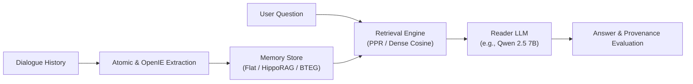

# Graph Memory: Bi-Temporal Graph Memory for Long-Term Conversations

[](https://www.python.org/downloads/)
[](https://docs.astral.sh/uv/)
[](LICENSE)

Rigorous evaluation harness and neurobiologically inspired graph memory engine for long-term LLM dialogue agents.

---

## Overview

Conversational agents interacting over long horizons need reliable episodic and semantic memory. **Graph Memory** evaluates and investigates:
1. **H1 — Structure vs. Extraction:** Does topological graph structure provide retrieval power beyond the raw factual extraction of an LLM? Evaluated across naive dense retrieval, flattened facts, HippoRAG, and Bi-Temporal Event Graphs (BTEG).
2. **H3 — Structural Quality & Utility Prediction:** Do cheap graph-topological metrics (degree Gini, largest component ratio, edge density, bridge edge ratio) statistically predict downstream QA utility?



---

## Repository Structure

The repository follows the modular architecture standard established by leading memory and Graph RAG repositories (RAW-RAG, HippoRAG, Mem0):

```text
graph-memory/
├── pyproject.toml                 # Package definition & uv / pytest configuration
├── README.md                      # Project documentation and quickstart
├── conf/                          # Composable Hydra configurations
│   ├── benchmark/                 # longmemeval.yaml, locomo.yaml
│   ├── mode/                      # vector.yaml, memory.yaml, full.yaml
│   ├── reader/                    # qwen25-7b.yaml
│   └── retriever/                 # minilm.yaml, gemma-300m.yaml, qwen3-06b.yaml
├── src/
│   ├── graph_memory/              # Core installable Python package
│   │   ├── cli.py                 # Unified CLI (graph-memory)
│   │   ├── colab_mgr.py           # Remote Colab lifecycle manager (colab-mgr)
│   │   ├── core/                  # Engine primitives: config, manifest, llm, embed
│   │   ├── memory/                # Memory backends: Flat, HippoRAG, Temporal BTEG
│   │   ├── pipeline/              # Ingestion, extraction, answering, and evaluation
│   │   └── analysis/              # Post-hoc rescoring, graph metrics, table generators
│   └── *.py                       # Backward-compatibility shims for legacy scripts
├── scripts/
│   └── colab/                     # Colab automation scripts and keepalive daemons
├── tests/                         # Full pytest verification suite
├── results/                       # Canonical experiment outputs and summary tables
└── cache/                         # Deterministic, content-hashed disk caches
```

---

## Quickstart (Using `uv`)

This project uses [`uv`](https://docs.astral.sh/uv/) for fast, deterministic dependency resolution.

### 1. Installation

```bash
# Clone the repository
git clone https://github.com/AmirBnsL/graph-memory.git
cd graph-memory

# Create virtual environment and install in editable mode with tests
uv venv
source .venv/bin/activate
uv pip install -e ".[test]"
```

### 2. Configure Environment

Create `.env` for LLM provider credentials (if using remote API models):

```dotenv
OPENAI_API_KEY=your_key_here
# Optional Ollama / Local host endpoints:
OLLAMA_BASE_URL=http://localhost:11434
```

---

## Running Experiments

### Unified CLI (`graph-memory`)

The unified CLI provides declarative access to evaluations, metrics, and leaderboards:

```bash
# Quick dry run on LongMemEval (5 conversations)
uv run graph-memory run --benchmark longmemeval --mode memory/hipporag --k 10 --limit 5

# Full evaluation with HippoRAG
uv run graph-memory run --benchmark longmemeval --mode memory/hipporag -k 10

# Bi-Temporal Event Graph (BTEG) evaluation
uv run graph-memory run --benchmark longmemeval --mode memory/temporal_bteg -k 10

# Generate summary Markdown/LaTeX leaderboard tables
uv run graph-memory tables

# Compute graph topology metrics
uv run graph-memory metrics
```

### Advanced Hydra Overrides

Pass fine-grained Hydra configuration parameters directly:

```bash
uv run graph-memory eval benchmark=longmemeval mode=memory/hipporag retriever=qwen3-06b k=10
```

---

## Reproducible Colab Workflow (`colab-mgr`)

For GPU-accelerated sweeps on Google Colab, use the built-in lifecycle manager:

```bash
# 1. Bundle and upload workspace to Colab VM
uv run colab-mgr setup -s gm-dev

# 2. Launch background parameter sweep (detached)
uv run colab-mgr sweep -s gm-dev --sweep 2,5,10,25,50 --retriever qwen3-06b

# 3. Monitor live log
uv run colab-mgr tail -s gm-dev -n 50

# 4. Safely pull completed results and manifests
uv run colab-mgr pull -s gm-dev

# 5. Keep VM alive during execution
uv run colab-mgr keepalive -s gm-dev
```

---

## Verification & Testing

Run the automated test suite with `uv`:

```bash
uv run --no-sync pytest
```

All 30 unit and integration tests verify:
- Package exports and CLI functionality
- LongMemEval and LoCoMo loaders
- Entity and OpenIE extraction parsing
- Memory backends (Flat, HippoRAG, Temporal BTEG)
- Graph metrics and utility regressions

---

## Benchmarks

- **LongMemEval** (`data/longmemeval`): 500 long-term multi-session dialogue understanding tasks with verified ground-truth provenance.
- **LoCoMo** (`data/locomo`): 10 multi-session conversations, 1,540 non-adversarial questions spanning single-hop, multi-hop, temporal reasoning, and open-domain tasks.

---

## License

This project is licensed under the MIT License. Benchmark datasets and external dependencies retain their respective licenses.
