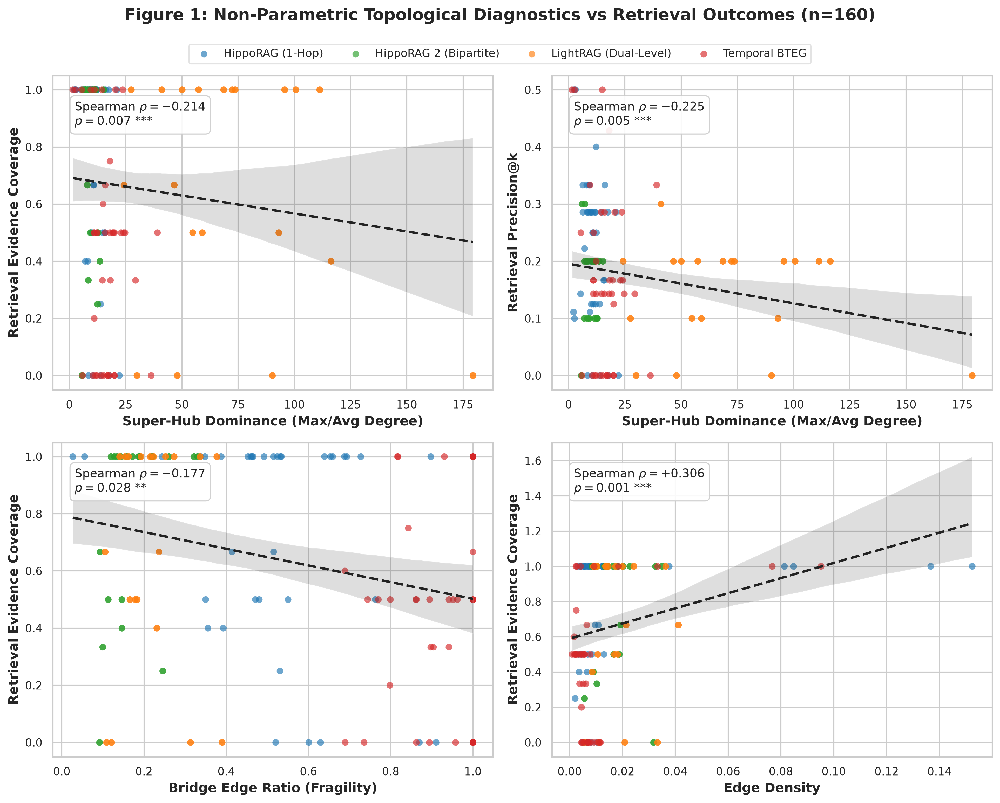
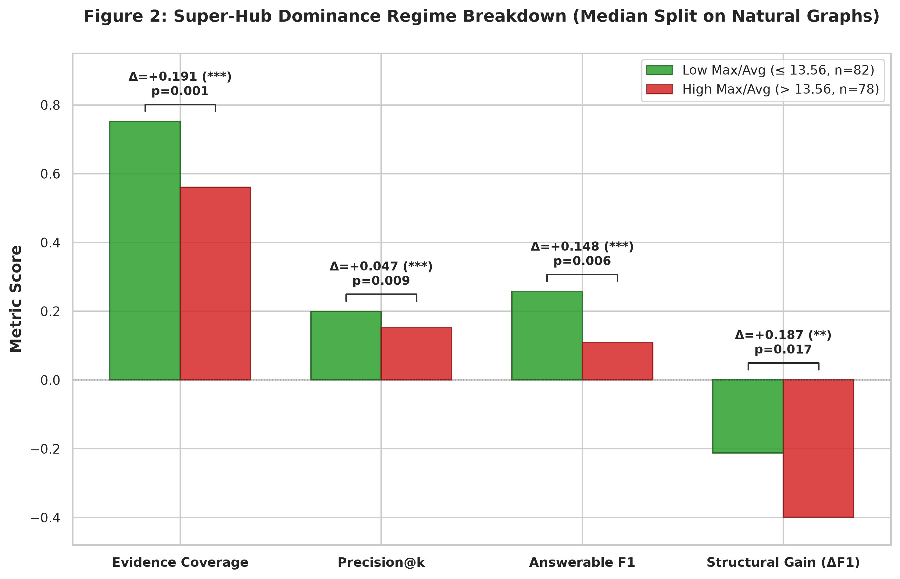
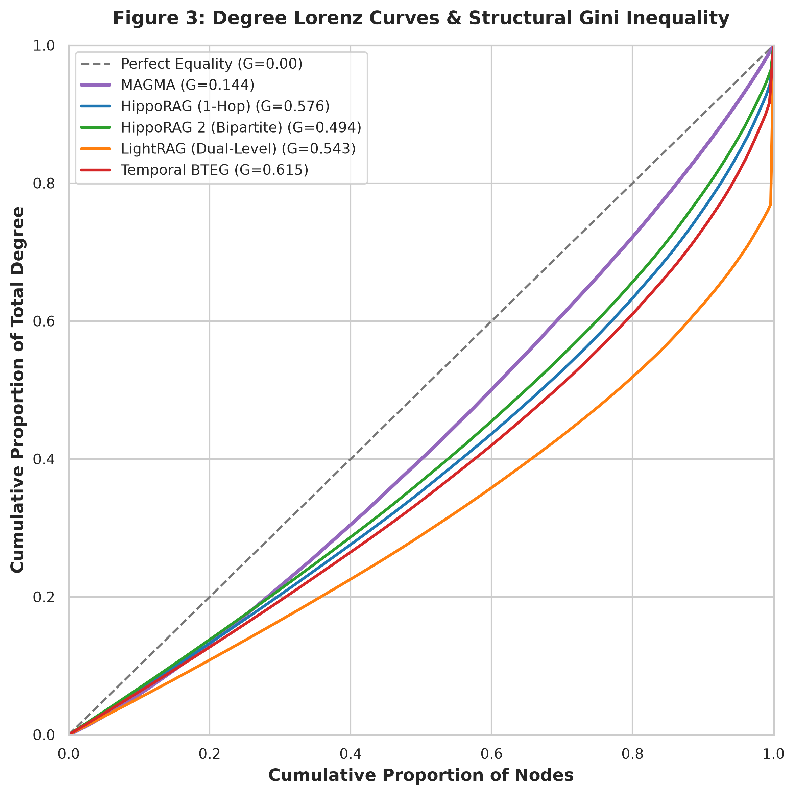
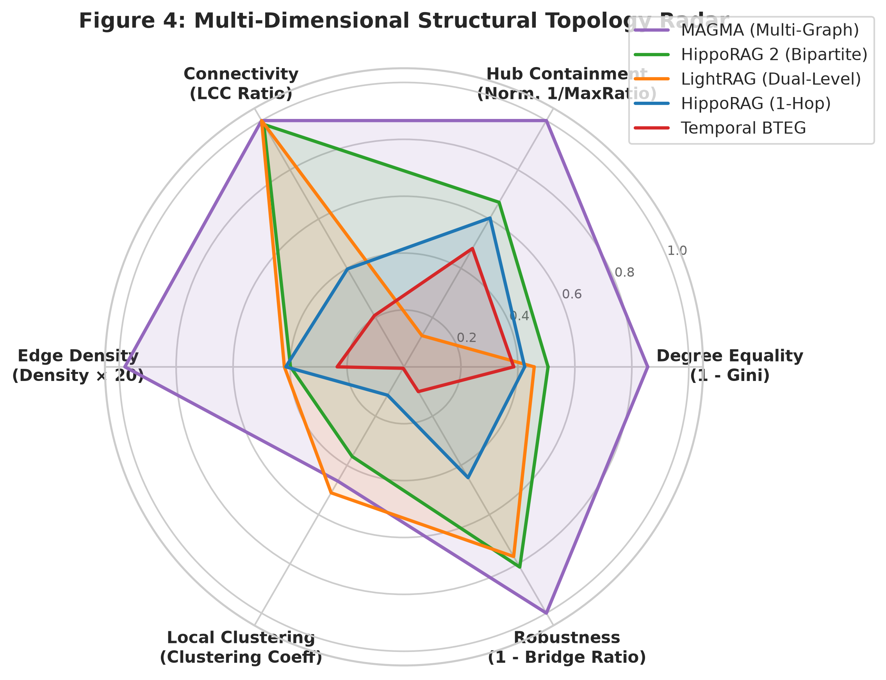

<!-- GENERATED by src/make_tables.py -- do not edit by hand -->

Rows are keyed by **(benchmark, mode, retriever, extractor, k, n)**. `n` is part of the key: the 25-QA balanced subset and the 500-QA full split are different measurements and are never merged into one row. The `file` column is the run id; its timestamp prefix is the run start (UTC). Scoring conventions: `F1` scores adversarial as 0 (floor), `F1_paper` scores correct refusal as a hit (LoCoMo convention), `F1_answerable` covers categories 1-4 only.

### All runs (latest per benchmark · mode · retriever · extractor · k · n)

| benchmark | mode | k | retriever | extractor | n | F1 | F1_paper | EM | F1_answerable | refusal_acc | recall_any | recall_all | coverage | prompt chars | latency s | file |
|---|---|---|---|---|---|---|---|---|---|---|---|---|---|---|---|---|
| locomo | vector | 2 | all-MiniLM-L6-v2 | – | 1986 | 0.076 | 0.282 | 0.037 | 0.098 | 0.919 | 0.162 | 0.136 | 0.148 | 299 | 0.33 | 20261018-214638_vector_k2_qwen2.5:7b-instruct.json |
| locomo | vector | 5 | all-MiniLM-L6-v2 | – | 1986 | 0.118 | 0.316 | 0.059 | 0.153 | 0.879 | 0.259 | 0.214 | 0.234 | 748 | 0.46 | 20261018-220153_vector_k5_qwen2.5:7b-instruct.json |
| locomo | vector | 10 | all-MiniLM-L6-v2 | – | 50 | 0.139 | – | 0.000 | – | – | – | – | – | 1552 | 0.26 | 20261017-220007_vector_k10_qwen2.5:7b-instruct.json |
| locomo | vector | 10 | all-MiniLM-L6-v2 | – | 1986 | 0.158 | 0.341 | 0.074 | 0.203 | 0.816 | 0.346 | 0.288 | 0.314 | 1503 | 0.74 | 20261018-222616_vector_k10_qwen2.5:7b-instruct.json |
| locomo | vector | 25 | all-MiniLM-L6-v2 | – | 1986 | 0.209 | 0.372 | 0.097 | 0.270 | 0.726 | 0.488 | 0.407 | 0.444 | 3863 | 1.53 | 20261018-231648_vector_k25_qwen2.5:7b-instruct.json |
| locomo | vector | 2 | Qwen/Qwen3-Embedding-0.6B | – | 1986 | 0.077 | 0.283 | 0.038 | 0.099 | 0.915 | 0.185 | 0.152 | 0.166 | 335 | 0.24 | 20261019-214520_vector_k2_qwen2.5:7b-instruct.json |
| locomo | vector | 5 | Qwen/Qwen3-Embedding-0.6B | – | 1986 | 0.131 | 0.330 | 0.063 | 0.169 | 0.883 | 0.285 | 0.241 | 0.261 | 832 | 0.22 | 20261019-215229_vector_k5_qwen2.5:7b-instruct.json |
| locomo | vector | 10 | Qwen/Qwen3-Embedding-0.6B | – | 1986 | 0.161 | 0.346 | 0.080 | 0.208 | 0.823 | 0.366 | 0.308 | 0.333 | 1652 | 0.28 | 20261019-220137_vector_k10_qwen2.5:7b-instruct.json |
| locomo | vector | 25 | Qwen/Qwen3-Embedding-0.6B | – | 1986 | 0.224 | 0.389 | 0.115 | 0.289 | 0.735 | 0.503 | 0.416 | 0.454 | 4109 | 0.44 | 20261019-221610_vector_k25_qwen2.5:7b-instruct.json |
| locomo | vector | 50 | Qwen/Qwen3-Embedding-0.6B | – | 1986 | 0.267 | 0.419 | 0.139 | 0.345 | 0.675 | 0.647 | 0.546 | 0.594 | 8290 | 0.74 | 20261019-224044_vector_k50_qwen2.5:7b-instruct.json |
| longmemeval | memory_flat | 10 | Qwen/Qwen3-Embedding-0.6B | qwen2.5:14b-instruct | 25 | 0.408 | 0.608 | 0.320 | 0.510 | 1.000 | 0.958 | 0.708 | 0.838 | 2398 | 2.74 | 20261025-132854_longmemeval_memory_flat_k10_qwen2.5:7b-instruct_ext-qwen2.5:14b-instruct.json |
| longmemeval | memory_flat | 10 | Qwen/Qwen3-Embedding-0.6B | qwen2.5:7b-instruct | 25 | 0.418 | 0.618 | 0.360 | 0.523 | 1.000 | 0.917 | 0.750 | 0.851 | 2281 | 2.52 | 20261023-105519_longmemeval_memory_flat_k10_qwen2.5:7b-instruct.json |
| longmemeval | memory_flat | 10 | all-MiniLM-L6-v2 | qwen2.5:7b-instruct | 25 | 0.243 | 0.443 | 0.200 | 0.303 | 1.000 | 0.917 | 0.583 | 0.761 | 2959 | 1.20 | 20261022-092917_longmemeval_memory_flat_k10_qwen2.5:7b-instruct.json |
| longmemeval | memory_hipporag | 10 | Qwen/Qwen3-Embedding-0.6B | qwen2.5:14b-instruct | 25 | 0.379 | 0.539 | 0.320 | 0.473 | 0.800 | 0.833 | 0.625 | 0.732 | 3122 | 8.24 | 20261025-133221_longmemeval_memory_hipporag_k10_qwen2.5:7b-instruct_ext-qwen2.5:14b-instruct.json |
| longmemeval | memory_hipporag | 10 | Qwen/Qwen3-Embedding-0.6B | qwen2.5:7b-instruct | 25 | 0.344 | 0.544 | 0.280 | 0.429 | 1.000 | 0.875 | 0.667 | 0.763 | 4018 | 13.04 | 20261023-110049_longmemeval_memory_hipporag_k10_qwen2.5:7b-instruct.json |
| longmemeval | memory_hipporag | 10 | all-MiniLM-L6-v2 | qwen2.5:7b-instruct | 25 | 0.072 | 0.232 | 0.040 | 0.090 | 0.800 | 0.458 | 0.042 | 0.246 | 3468 | 3.99 | 20261022-093059_longmemeval_memory_hipporag_k10_qwen2.5:7b-instruct.json |
| longmemeval | memory_hipporag2 | 10 | Qwen/Qwen3-Embedding-0.6B | qwen2.5:14b-instruct | 25 | 0.046 | 0.246 | 0.000 | 0.057 | 1.000 | 0.917 | 0.667 | 0.777 | 8796 | 0.17 | 20261026-183217_longmemeval_memory_hipporag2_k10_qwen2.5:7b-instruct_ext-qwen2.5:14b-instruct.json |
| longmemeval | memory_hipporag2 | 10 | Qwen/Qwen3-Embedding-0.6B | qwen2.5:7b-instruct | 25 | 0.046 | 0.246 | 0.000 | 0.057 | 1.000 | 0.917 | 0.667 | 0.777 | 8796 | 65.66 | 20261026-183207_longmemeval_memory_hipporag2_k10_qwen2.5:7b-instruct.json |
| longmemeval | memory_hipporag_flattened | 10 | Qwen/Qwen3-Embedding-0.6B | qwen2.5:14b-instruct | 25 | 0.405 | 0.605 | 0.320 | 0.507 | 1.000 | 0.917 | 0.667 | 0.787 | 2680 | 0.56 | 20261025-133551_longmemeval_memory_hipporag_flattened_k10_qwen2.5:7b-instruct_ext-qwen2.5:14b-instruct.json |
| longmemeval | memory_hipporag_flattened | 10 | Qwen/Qwen3-Embedding-0.6B | qwen2.5:7b-instruct | 25 | 0.345 | 0.545 | 0.320 | 0.432 | 1.000 | 0.958 | 0.708 | 0.829 | 3516 | 1.89 | 20261023-110139_longmemeval_memory_hipporag_flattened_k10_qwen2.5:7b-instruct.json |
| longmemeval | memory_hipporag_flattened | 10 | all-MiniLM-L6-v2 | qwen2.5:7b-instruct | 25 | 0.161 | 0.361 | 0.120 | 0.202 | 1.000 | 0.750 | 0.292 | 0.524 | 6221 | 1.30 | 20261022-093135_longmemeval_memory_hipporag_flattened_k10_qwen2.5:7b-instruct.json |
| longmemeval | memory_hipporag_rewired | 10 | Qwen/Qwen3-Embedding-0.6B | qwen2.5:14b-instruct | 25 | 0.274 | 0.434 | 0.200 | 0.343 | 0.800 | 0.917 | 0.583 | 0.753 | 2827 | 7.81 | 20261025-133537_longmemeval_memory_hipporag_rewired_k10_qwen2.5:7b-instruct_ext-qwen2.5:14b-instruct.json |
| longmemeval | memory_hipporag_rewired | 10 | Qwen/Qwen3-Embedding-0.6B | qwen2.5:7b-instruct | 25 | 0.360 | 0.560 | 0.320 | 0.450 | 1.000 | 0.833 | 0.625 | 0.722 | 3912 | 26.60 | 20261025-111954_longmemeval_memory_hipporag_rewired_k10_qwen2.5:7b-instruct.json |
| longmemeval | memory_lightrag | 10 | Qwen/Qwen3-Embedding-0.6B | qwen2.5:14b-instruct | 25 | 0.048 | 0.248 | 0.000 | 0.060 | 1.000 | 0.792 | 0.542 | 0.676 | 10271 | 0.20 | 20261026-183222_longmemeval_memory_lightrag_k10_qwen2.5:7b-instruct_ext-qwen2.5:14b-instruct.json |
| longmemeval | memory_lightrag | 10 | Qwen/Qwen3-Embedding-0.6B | qwen2.5:7b-instruct | 25 | 0.048 | 0.248 | 0.000 | 0.060 | 1.000 | 0.792 | 0.542 | 0.676 | 10271 | 0.20 | 20261026-183213_longmemeval_memory_lightrag_k10_qwen2.5:7b-instruct.json |
| longmemeval | memory_temporal_bteg | 10 | Qwen/Qwen3-Embedding-0.6B | qwen2.5:14b-instruct | 25 | 0.116 | 0.316 | 0.080 | 0.145 | 1.000 | 0.667 | 0.208 | 0.435 | 1272 | 1.10 | 20261025-133619_longmemeval_memory_temporal_bteg_k10_qwen2.5:7b-instruct_ext-qwen2.5:14b-instruct.json |
| longmemeval | memory_temporal_bteg | 10 | Qwen/Qwen3-Embedding-0.6B | qwen2.5:7b-instruct | 25 | 0.160 | 0.360 | 0.160 | 0.200 | 1.000 | 0.750 | 0.292 | 0.511 | 1347 | 1.90 | 20261023-110230_longmemeval_memory_temporal_bteg_k10_qwen2.5:7b-instruct.json |
| longmemeval | memory_temporal_bteg | 10 | all-MiniLM-L6-v2 | qwen2.5:7b-instruct | 25 | 0.193 | 0.353 | 0.160 | 0.241 | 0.800 | 0.792 | 0.417 | 0.583 | 916 | 0.93 | 20261022-093202_longmemeval_memory_temporal_bteg_k10_qwen2.5:7b-instruct.json |
| longmemeval | vector | 5 | Qwen/Qwen3-Embedding-0.6B | – | 500 | 0.417 | 0.471 | 0.320 | 0.443 | 0.900 | 0.939 | 0.708 | 0.824 | 2386 | 1.33 | 20261020-131028_longmemeval_vector_k5_qwen2.5:7b-instruct.json |
| longmemeval | vector | 10 | Qwen/Qwen3-Embedding-0.6B | – | 25 | 0.393 | 0.553 | 0.320 | 0.491 | 0.800 | 1.000 | 0.875 | 0.947 | 6293 | 3.59 | 20261023-105411_longmemeval_vector_k10_qwen2.5:7b-instruct.json |
| longmemeval | vector | 10 | Qwen/Qwen3-Embedding-0.6B | – | 500 | 0.444 | 0.500 | 0.336 | 0.472 | 0.933 | 0.996 | 0.916 | 0.963 | 6732 | 0.78 | 20261020-131659_longmemeval_vector_k10_qwen2.5:7b-instruct.json |
| longmemeval | vector | 10 | all-MiniLM-L6-v2 | – | 25 | 0.214 | 0.414 | 0.160 | 0.268 | 1.000 | 0.917 | 0.667 | 0.796 | 12060 | 2.94 | 20261022-092841_longmemeval_vector_k10_qwen2.5:7b-instruct.json |
| longmemeval | vector | 25 | all-MiniLM-L6-v2 | – | 500 | 0.388 | 0.442 | 0.290 | 0.412 | 0.900 | 0.996 | 0.948 | 0.978 | 23845 | 2.47 | 20261020-152648_longmemeval_vector_k25_qwen2.5:7b-instruct.json |

### Hypothesis 1 (Table 1): Overall Structure vs. Extraction Decomposition (`F1_answerable`)

| benchmark | retriever | extractor | k | n | Vector Baseline | Flat Memory | Concept Graph | Rewired Graph | Flattened Graph | Bi-Temporal Event Graph (BTEG) | Bipartite Concept Graph (HippoRAG 2) | Dual-Level Graph (LightRAG) | Δ_extraction | Δ_entity_bottleneck | Δ_topology | Δ_rewire | Δ_temporal | Δ_hipporag2 | Δ_lightrag |
|---|---|---|---|---|---|---|---|---|---|---|---|---|---|---|---|---|---|---|---|
| longmemeval | Qwen/Qwen3-Embedding-0.6B | qwen2.5:14b-instruct | 10 | 25 | 0.491 | 0.510 | 0.473 | 0.343 | 0.507 | 0.145 | 0.057 | 0.060 | +0.018 | -0.003 | -0.033 | +0.130 | -0.365 | -0.453 | -0.450 |
| longmemeval | Qwen/Qwen3-Embedding-0.6B | qwen2.5:7b-instruct | 10 | 25 | 0.491 | 0.523 | 0.429 | 0.450 | 0.432 | 0.200 | 0.057 | 0.060 | +0.032 | -0.091 | -0.002 | -0.020 | -0.323 | -0.466 | -0.463 |
| longmemeval | all-MiniLM-L6-v2 | qwen2.5:7b-instruct | 10 | 25 | 0.268 | 0.303 | 0.090 | – | 0.202 | 0.241 | – | – | +0.035 | -0.102 | -0.112 | – | -0.062 | – | – |

### Hypothesis 1 (Table 2): Category-Stratified F1 & Abstention Breakdown

Categories 1–4 report token `F1`; Category 5 (`abstention`/`adversarial`) reports `refusal_accuracy`.

#### `longmemeval` · retriever=`Qwen/Qwen3-Embedding-0.6B` · extractor=`qwen2.5:14b-instruct` · `k=10` · `n=25`

| Arm / Comparison | Cat 1: extraction | Cat 2: multi-session | Cat 3: temporal | Cat 4: update | Cat 5: abstention (refusal) | F1_answerable |
|---|---|---|---|---|---|---|
| Vector Baseline | 0.612 | 0.080 | 0.473 | 0.800 | 0.800 | 0.491 |
| Flat Memory | 0.345 | 0.413 | 0.400 | 0.880 | 1.000 | 0.510 |
| Concept Graph | 0.533 | 0.280 | 0.400 | 0.680 | 0.800 | 0.473 |
| Rewired Graph | 0.545 | 0.080 | 0.200 | 0.547 | 0.800 | 0.343 |
| Flattened Graph | 0.533 | 0.213 | 0.600 | 0.680 | 1.000 | 0.507 |
| Bi-Temporal Event Graph (BTEG) | 0.200 | 0.000 | 0.200 | 0.180 | 1.000 | 0.145 |
| Bipartite Concept Graph (HippoRAG 2) | 0.103 | 0.033 | 0.076 | 0.016 | 1.000 | 0.057 |
| Dual-Level Graph (LightRAG) | 0.129 | 0.006 | 0.081 | 0.024 | 1.000 | 0.060 |
| **Δ_extraction (Flat Memory - Vector Baseline)** | -0.267 | +0.333 | -0.073 | +0.080 | +0.200 | **+0.018** |
| **Δ_entity_bottleneck (Flattened Graph - Flat Memory)** | +0.188 | -0.200 | +0.200 | -0.200 | +0.000 | **-0.003** |
| **Δ_topology (Concept Graph - Flattened Graph)** | +0.000 | +0.067 | -0.200 | +0.000 | -0.200 | **-0.033** |
| **Δ_rewire (Concept Graph - Rewired Graph)** | -0.012 | +0.200 | +0.200 | +0.133 | +0.000 | **+0.130** |
| **Δ_temporal (BTEG - Flat Memory)** | -0.145 | -0.413 | -0.200 | -0.700 | +0.000 | **-0.365** |
| **Δ_hipporag2 (HippoRAG 2 - Flat Memory)** | -0.242 | -0.380 | -0.324 | -0.864 | +0.000 | **-0.453** |
| **Δ_lightrag (LightRAG - Flat Memory)** | -0.216 | -0.407 | -0.319 | -0.856 | +0.000 | **-0.450** |

#### `longmemeval` · retriever=`Qwen/Qwen3-Embedding-0.6B` · extractor=`qwen2.5:7b-instruct` · `k=10` · `n=25`

| Arm / Comparison | Cat 1: extraction | Cat 2: multi-session | Cat 3: temporal | Cat 4: update | Cat 5: abstention (refusal) | F1_answerable |
|---|---|---|---|---|---|---|
| Vector Baseline | 0.612 | 0.080 | 0.473 | 0.800 | 0.800 | 0.491 |
| Flat Memory | 0.331 | 0.280 | 0.600 | 0.880 | 1.000 | 0.523 |
| Concept Graph | 0.391 | 0.200 | 0.247 | 0.880 | 1.000 | 0.429 |
| Rewired Graph | 0.342 | 0.000 | 0.657 | 0.800 | 1.000 | 0.450 |
| Flattened Graph | 0.400 | 0.000 | 0.447 | 0.880 | 1.000 | 0.432 |
| Bi-Temporal Event Graph (BTEG) | 0.200 | 0.000 | 0.200 | 0.400 | 1.000 | 0.200 |
| Bipartite Concept Graph (HippoRAG 2) | 0.103 | 0.033 | 0.076 | 0.016 | 1.000 | 0.057 |
| Dual-Level Graph (LightRAG) | 0.129 | 0.006 | 0.081 | 0.024 | 1.000 | 0.060 |
| **Δ_extraction (Flat Memory - Vector Baseline)** | -0.281 | +0.200 | +0.127 | +0.080 | +0.200 | **+0.032** |
| **Δ_entity_bottleneck (Flattened Graph - Flat Memory)** | +0.069 | -0.280 | -0.153 | +0.000 | +0.000 | **-0.091** |
| **Δ_topology (Concept Graph - Flattened Graph)** | -0.009 | +0.200 | -0.200 | +0.000 | +0.000 | **-0.002** |
| **Δ_rewire (Concept Graph - Rewired Graph)** | +0.049 | +0.200 | -0.410 | +0.080 | +0.000 | **-0.020** |
| **Δ_temporal (BTEG - Flat Memory)** | -0.131 | -0.280 | -0.400 | -0.480 | +0.000 | **-0.323** |
| **Δ_hipporag2 (HippoRAG 2 - Flat Memory)** | -0.228 | -0.247 | -0.524 | -0.864 | +0.000 | **-0.466** |
| **Δ_lightrag (LightRAG - Flat Memory)** | -0.202 | -0.274 | -0.519 | -0.856 | +0.000 | **-0.463** |

#### `longmemeval` · retriever=`all-MiniLM-L6-v2` · extractor=`qwen2.5:7b-instruct` · `k=10` · `n=25`

| Arm / Comparison | Cat 1: extraction | Cat 2: multi-session | Cat 3: temporal | Cat 4: update | Cat 5: abstention (refusal) | F1_answerable |
|---|---|---|---|---|---|---|
| Vector Baseline | 0.019 | 0.080 | 0.473 | 0.500 | 1.000 | 0.268 |
| Flat Memory | 0.000 | 0.080 | 0.453 | 0.680 | 1.000 | 0.303 |
| Concept Graph | 0.000 | 0.000 | 0.200 | 0.160 | 0.800 | 0.090 |
| Flattened Graph | 0.000 | 0.000 | 0.447 | 0.360 | 1.000 | 0.202 |
| Bi-Temporal Event Graph (BTEG) | 0.000 | 0.000 | 0.483 | 0.480 | 0.800 | 0.241 |
| **Δ_extraction (Flat Memory - Vector Baseline)** | -0.019 | +0.000 | -0.019 | +0.180 | +0.000 | **+0.035** |
| **Δ_entity_bottleneck (Flattened Graph - Flat Memory)** | +0.000 | -0.080 | -0.006 | -0.320 | +0.000 | **-0.102** |
| **Δ_topology (Concept Graph - Flattened Graph)** | +0.000 | +0.000 | -0.247 | -0.200 | -0.200 | **-0.112** |
| **Δ_temporal (BTEG - Flat Memory)** | +0.000 | -0.080 | +0.030 | -0.200 | -0.200 | **-0.062** |

### Hypothesis 1 (Table 3): Paired Statistical Significance (Answerable Qs, Cat 1–4)

95% confidence intervals use 10,000-draw conversation-cluster bootstrap (`sample_id` clusters). `p_perm (ΔF1)` is the two-sided cluster sign-flip permutation p-value; `p_McNemar` is the exact two-sided binomial test on discordant pairs `(A+,B- / A-,B+)`.

| benchmark | retriever | extractor | k | Comparison (A vs B) | n_pairs (clusters) | ΔF1_ans | 95% Cluster CI | p_perm (ΔF1) | EM (A+,B- / A-,B+) | p_McNemar (EM) | Recall (A+,B- / A-,B+) | p_McNemar (Rec) |
|---|---|---|---|---|---|---|---|---|---|---|---|---|
| longmemeval | Qwen/Qwen3-Embedding-0.6B | qwen2.5:14b-instruct | 10 | Flat Memory vs Vector Baseline (Δ_extraction) | 20 (20) | +0.018 | [-0.200, +0.235] | 0.875 | 2/2 | 1.000 | 0/1 | 1.000 |
| longmemeval | Qwen/Qwen3-Embedding-0.6B | qwen2.5:14b-instruct | 10 | Flattened Graph vs Flat Memory (Δ_entity_bottleneck) | 20 (20) | -0.003 | [-0.214, +0.201] | 1.000 | 2/2 | 1.000 | 1/1 | 1.000 |
| longmemeval | Qwen/Qwen3-Embedding-0.6B | qwen2.5:14b-instruct | 10 | Concept Graph vs Flattened Graph (Δ_topology) | 20 (20) | -0.033 | [-0.183, +0.117] | 1.000 | 1/1 | 1.000 | 0/2 | 0.500 |
| longmemeval | Qwen/Qwen3-Embedding-0.6B | qwen2.5:14b-instruct | 10 | Concept Graph vs Rewired Graph (Δ_rewire) | 20 (20) | +0.130 | [-0.082, +0.344] | 0.303 | 4/1 | 0.375 | 0/1 | 1.000 |
| longmemeval | Qwen/Qwen3-Embedding-0.6B | qwen2.5:14b-instruct | 10 | Bi-Temporal Event Graph vs Flat Memory (Δ_temporal) | 20 (20) | -0.365 | [-0.579, -0.139] | 0.007 | 1/7 | 0.070 | 0/6 | 0.031 |
| longmemeval | Qwen/Qwen3-Embedding-0.6B | qwen2.5:14b-instruct | 10 | Bipartite Concept Graph vs Flat Memory (Δ_hipporag2) | 15 (15) | -0.523 | [-0.749, -0.279] | 0.003 | 0/7 | 0.016 | 0/0 | 1.000 |
| longmemeval | Qwen/Qwen3-Embedding-0.6B | qwen2.5:14b-instruct | 10 | Dual-Level Graph vs Flat Memory (Δ_lightrag) | 15 (15) | -0.527 | [-0.748, -0.290] | 0.003 | 0/7 | 0.016 | 0/2 | 0.500 |
| longmemeval | Qwen/Qwen3-Embedding-0.6B | qwen2.5:7b-instruct | 10 | Flat Memory vs Vector Baseline (Δ_extraction) | 20 (20) | +0.032 | [-0.125, +0.215] | 0.737 | 2/1 | 1.000 | 0/2 | 0.500 |
| longmemeval | Qwen/Qwen3-Embedding-0.6B | qwen2.5:7b-instruct | 10 | Flattened Graph vs Flat Memory (Δ_entity_bottleneck) | 20 (20) | -0.091 | [-0.253, +0.045] | 0.315 | 1/2 | 1.000 | 1/0 | 1.000 |
| longmemeval | Qwen/Qwen3-Embedding-0.6B | qwen2.5:7b-instruct | 10 | Concept Graph vs Flattened Graph (Δ_topology) | 20 (20) | -0.002 | [-0.202, +0.200] | 1.000 | 2/3 | 1.000 | 0/1 | 1.000 |
| longmemeval | Qwen/Qwen3-Embedding-0.6B | qwen2.5:7b-instruct | 10 | Concept Graph vs Rewired Graph (Δ_rewire) | 20 (20) | -0.020 | [-0.200, +0.151] | 0.858 | 1/2 | 1.000 | 0/0 | 1.000 |
| longmemeval | Qwen/Qwen3-Embedding-0.6B | qwen2.5:7b-instruct | 10 | Bi-Temporal Event Graph vs Flat Memory (Δ_temporal) | 20 (20) | -0.323 | [-0.515, -0.150] | 0.003 | 0/5 | 0.062 | 0/3 | 0.250 |
| longmemeval | Qwen/Qwen3-Embedding-0.6B | qwen2.5:7b-instruct | 10 | Bipartite Concept Graph vs Flat Memory (Δ_hipporag2) | 15 (15) | -0.545 | [-0.769, -0.305] | 0.002 | 0/8 | 0.008 | 0/0 | 1.000 |
| longmemeval | Qwen/Qwen3-Embedding-0.6B | qwen2.5:7b-instruct | 10 | Dual-Level Graph vs Flat Memory (Δ_lightrag) | 15 (15) | -0.550 | [-0.768, -0.317] | 0.002 | 0/8 | 0.008 | 0/2 | 0.500 |
| longmemeval | all-MiniLM-L6-v2 | qwen2.5:7b-instruct | 10 | Flat Memory vs Vector Baseline (Δ_extraction) | 20 (20) | +0.035 | [-0.165, +0.240] | 0.811 | 3/2 | 1.000 | 1/1 | 1.000 |
| longmemeval | all-MiniLM-L6-v2 | qwen2.5:7b-instruct | 10 | Flattened Graph vs Flat Memory (Δ_entity_bottleneck) | 20 (20) | -0.102 | [-0.323, +0.127] | 0.416 | 2/4 | 0.688 | 0/4 | 0.125 |
| longmemeval | all-MiniLM-L6-v2 | qwen2.5:7b-instruct | 10 | Concept Graph vs Flattened Graph (Δ_topology) | 20 (20) | -0.112 | [-0.262, +0.000] | 0.250 | 0/2 | 0.500 | 1/6 | 0.125 |
| longmemeval | all-MiniLM-L6-v2 | qwen2.5:7b-instruct | 10 | Bi-Temporal Event Graph vs Flat Memory (Δ_temporal) | 20 (20) | -0.062 | [-0.241, +0.108] | 0.527 | 1/2 | 1.000 | 1/4 | 0.375 |

### Hypothesis 2 (Table 1): Mean Topological Graph Metrics Across Runs

| benchmark | mode | retriever | extractor | k | n | Nodes | Edges | LCC Ratio (ρ_LCC) | Components | Degree Gini (G_deg) | Max/Avg Deg | Density | Clustering | Bridge Ratio | Temporal Ratio | Superseded Ratio |
|---|---|---|---|---|---|---|---|---|---|---|---|---|---|---|---|---|
| longmemeval | memory_hipporag | Qwen/Qwen3-Embedding-0.6B | qwen2.5:14b-instruct | 10 | 25 | 192.8 | 159.2 | 0.397 | 69.5 | 0.576 | 11.54 | 0.0166 | 0.115 | 0.550 | 0.000 | 0.000 |
| longmemeval | memory_hipporag | Qwen/Qwen3-Embedding-0.6B | qwen2.5:7b-instruct | 10 | 25 | 235.1 | 162.0 | 0.350 | 108.6 | 0.590 | 10.58 | 0.0162 | 0.093 | 0.569 | 0.000 | 0.000 |
| longmemeval | memory_hipporag2 | Qwen/Qwen3-Embedding-0.6B | qwen2.5:14b-instruct | 10 | 25 | 272.6 | 490.8 | 0.984 | 1.5 | 0.494 | 9.97 | 0.0159 | 0.364 | 0.187 | 0.000 | 0.000 |
| longmemeval | memory_hipporag2 | Qwen/Qwen3-Embedding-0.6B | qwen2.5:7b-instruct | 10 | 25 | 272.6 | 490.8 | 0.984 | 1.5 | 0.494 | 9.97 | 0.0159 | 0.364 | 0.187 | 0.000 | 0.000 |
| longmemeval | memory_hipporag_flattened | Qwen/Qwen3-Embedding-0.6B | qwen2.5:14b-instruct | 10 | 25 | 192.8 | 0.0 | 0.008 | 192.8 | 0.000 | 0.00 | 0.0000 | 0.000 | 0.000 | 0.000 | 0.000 |
| longmemeval | memory_hipporag_flattened | Qwen/Qwen3-Embedding-0.6B | qwen2.5:7b-instruct | 10 | 25 | 235.1 | 0.0 | 0.008 | 235.1 | 0.000 | 0.00 | 0.0000 | 0.000 | 0.000 | 0.000 | 0.000 |
| longmemeval | memory_hipporag_rewired | Qwen/Qwen3-Embedding-0.6B | qwen2.5:14b-instruct | 10 | 25 | 192.8 | 159.2 | 0.585 | 66.8 | 0.576 | 11.54 | 0.0166 | 0.029 | 0.539 | 0.000 | 0.000 |
| longmemeval | memory_hipporag_rewired | Qwen/Qwen3-Embedding-0.6B | qwen2.5:7b-instruct | 10 | 25 | 236.4 | 164.4 | 0.532 | 102.9 | 0.589 | 10.31 | 0.0170 | 0.028 | 0.548 | 0.000 | 0.000 |
| longmemeval | memory_lightrag | Qwen/Qwen3-Embedding-0.6B | qwen2.5:14b-instruct | 10 | 25 | 248.3 | 418.4 | 1.000 | 1.0 | 0.543 | 74.00 | 0.0168 | 0.511 | 0.230 | 0.000 | 0.000 |
| longmemeval | memory_lightrag | Qwen/Qwen3-Embedding-0.6B | qwen2.5:7b-instruct | 10 | 25 | 248.3 | 418.4 | 1.000 | 1.0 | 0.543 | 74.00 | 0.0168 | 0.511 | 0.230 | 0.000 | 0.000 |
| longmemeval | memory_temporal_bteg | Qwen/Qwen3-Embedding-0.6B | qwen2.5:14b-instruct | 10 | 25 | 175.4 | 99.8 | 0.208 | 84.2 | 0.615 | 15.80 | 0.0094 | 0.006 | 0.899 | 1.000 | 0.051 |
| longmemeval | memory_temporal_bteg | Qwen/Qwen3-Embedding-0.6B | qwen2.5:7b-instruct | 10 | 25 | 221.7 | 85.5 | 0.141 | 140.7 | 0.654 | 17.19 | 0.0090 | 0.004 | 0.932 | 1.000 | 0.037 |

### Hypothesis 2 (Table 2): Univariate Topological Correlations (`n=160` natural graph QA observations)

Reports Spearman rank correlation `ρ` (and two-sided permutation `p`-value) between `O(|V|+|E|)` structural metrics and per-query retrieval/QA outcomes.

| Structural Predictor | ρ (Evidence Coverage) | p-val | ρ (Precision@k) | p-val | ρ (Answerable F1) | p-val | ρ (ΔF1 vs Flat) | p-val |
|---|---|---|---|---|---|---|---|---|
| `degree_gini` | -0.178 | 0.022 | +0.022 | 0.777 | -0.046 | 0.566 | -0.137 | 0.091 |
| `max_degree_ratio` | -0.214 | 0.009 | -0.225 | 0.006 | -0.098 | 0.219 | -0.101 | 0.220 |
| `largest_component_ratio` | +0.208 | 0.008 | -0.035 | 0.673 | +0.087 | 0.281 | +0.006 | 0.944 |
| `edge_density` | +0.306 | 0.000 | -0.038 | 0.645 | +0.249 | 0.001 | +0.086 | 0.286 |
| `clustering_coefficient` | +0.159 | 0.043 | -0.033 | 0.692 | +0.087 | 0.274 | +0.002 | 0.981 |
| `bridge_edge_ratio` | -0.177 | 0.024 | +0.039 | 0.632 | -0.089 | 0.265 | -0.012 | 0.874 |
| `temporal_edge_ratio` | -0.332 | 0.000 | -0.098 | 0.223 | -0.270 | 0.000 | -0.132 | 0.108 |
| `invalidated_edge_ratio` | -0.273 | 0.001 | -0.064 | 0.431 | -0.181 | 0.022 | -0.178 | 0.026 |

### Hypothesis 2 (Table 3): Multivariate OLS Regression (`Y ~ G_deg + MaxDegRatio + ρ_LCC + Density + BridgeRatio`)

Standardized OLS coefficients (`β`) and model fit (`R²`, `F`-stat, permutation `p`-value) testing the H2 falsification criterion (`R² >= 0.20`).

| Dependent Target (Y) | n | R² | Adj R² | F-stat | p-val (Model) | β (degree_gini) | β (max_deg_ratio) | β (LCC_ratio) | β (edge_density) | β (bridge_ratio) |
|---|---|---|---|---|---|---|---|---|---|---|
| Retrieval Evidence Coverage | 160 | **0.117** | 0.089 | 4.09 | 0.0020 | +0.008 | -0.148 | -0.003 | +0.165 | -0.264 |
| Retrieval Precision@k | 160 | **0.115** | 0.086 | 3.98 | 0.0027 | +0.019 | -0.103 | -0.246 | +0.301 | -0.193 |
| End-to-End Answerable F1 | 160 | **0.106** | 0.076 | 3.63 | 0.0037 | -0.091 | -0.083 | -0.394 | -0.022 | -0.095 |
| Structural Gain (ΔF1 vs Flat) | 160 | **0.070** | 0.039 | 2.30 | 0.0460 | -0.074 | -0.048 | -0.226 | +0.180 | -0.031 |

### Hypothesis 2 (Table 4): Topological Regime Breakdown (Median Splits on Natural Graphs)

Stratifies natural graph memory QA observations (`n=160`) at the median across the three core structural bottleneck dimensions. `Δ` reports the regime contrast (Low Hub vs High Hub; Connected vs Fragmented); `p`-values use two-sided two-sample permutation tests (2,500 draws).

| Structural Dimension | Partition Threshold | Regime | n | Evidence Coverage | Precision@k | Answerable F1 | ΔF1 vs Flat |
|---|---|---|---|---|---|---|---|
| **Hub Concentration** | Median G_deg = 0.545 | Low Degree Gini (≤ 0.545) | 81 | 0.690 | 0.170 | 0.133 | -0.270 |
| | | High Degree Gini (> 0.545) | 79 | 0.627 | 0.184 | 0.239 | -0.337 |
| | | **Regime Contrast (Low - High)** | – | **+0.063** (p=0.295) | **-0.014** (p=0.461) | **-0.106** (p=0.044) | **+0.067** (p=0.392) |
| **Super-Hub Dominance** | Median Max/Avg = 13.56 | Low Max Degree Ratio (≤ 13.56) | 82 | 0.752 | 0.200 | 0.257 | -0.212 |
| | | High Max Degree Ratio (> 13.56) | 78 | 0.561 | 0.153 | 0.110 | -0.399 |
| | | **Regime Contrast (Low - High)** | – | **+0.191** (p=0.001) | **+0.047** (p=0.009) | **+0.148** (p=0.006) | **+0.187** (p=0.017) |
| **Component Connectivity** | Median ρ_LCC = 0.913 | Fragmented Component Ratio (≤ 0.913) | 82 | 0.605 | 0.189 | 0.307 | -0.199 |
| | | Connected Component Ratio (> 0.913) | 78 | 0.715 | 0.164 | 0.057 | -0.412 |
| | | **Regime Contrast (Conn - Frag)** | – | **+0.110** (p=0.067) | **-0.025** (p=0.191) | **-0.251** (p=0.000) | **-0.213** (p=0.005) |

### Hypothesis 2 Diagnostic Figures

The following publication-quality diagnostic plots illustrate the non-parametric topological effects and regime boundaries evaluated on natural graph memory representations ($n=160$ natural graph QA observations plus unmodified upstream frameworks):

- **Figure 1: Non-Parametric Topological Diagnostics vs Retrieval Outcomes (OLS Regression & Scatter)**
  
  *Scatter plots and standardized OLS trendlines (with 95% confidence intervals) showing how Super-Hub Dominance ($\text{Max/Avg Degree}$) and Bridge Edge Fragility degrade Evidence Coverage and Precision@k.*

- **Figure 2: Super-Hub Dominance Regime Breakdown (Median Splits on Natural Graphs)**
  
  *Grouped bar chart depicting Table 4's median splits for Super-Hub Dominance ($\text{Max/Avg} \le 13.56$ vs $> 13.56$) across Evidence Coverage (+0.191 contrast, $p=0.001$), Precision@k (+0.047 contrast, $p=0.009$), Answerable F1 (+0.148 contrast, $p=0.006$), and Structural Gain $\Delta\text{F1}$ vs Flat (+0.187 contrast, $p=0.017$).*

- **Figure 3: Degree Lorenz Curves & Structural Gini Inequality**
  
  *Degree Lorenz curves measuring structural degree inequality across memory architectures. Unconstrained entity graphs (HippoRAG, BTEG) exhibit severe Gini bowing ($G \ge 0.58$), whereas episode-chunked multi-graphs (MAGMA, $G = 0.144$) stay close to the line of perfect equality.*

- **Figure 4: Multi-Dimensional Structural Topology Radar**
  
  *Radar chart contrasting the six-dimensional structural fingerprint (Degree Equality, Hub Containment, Connectivity, Density, Clustering, and Robustness) across HippoRAG, HippoRAG 2, LightRAG, Temporal BTEG, and MAGMA.*

### Retrieval recall by category: locomo

| mode | retriever | extractor | k | n | multi-hop | temporal | open-domain | single-hop | adversarial | overall |
|---|---|---|---|---|---|---|---|---|---|---|
| vector | all-MiniLM-L6-v2 | – | 2 | 1986 | 0.057 | 0.168 | 0.098 | 0.180 | 0.206 | 0.162 |
| vector | all-MiniLM-L6-v2 | – | 5 | 1986 | 0.167 | 0.243 | 0.130 | 0.273 | 0.327 | 0.259 |
| vector | all-MiniLM-L6-v2 | – | 10 | 1986 | 0.270 | 0.330 | 0.207 | 0.360 | 0.406 | 0.346 |
| vector | all-MiniLM-L6-v2 | – | 25 | 1986 | 0.450 | 0.452 | 0.250 | 0.510 | 0.547 | 0.488 |
| vector | Qwen/Qwen3-Embedding-0.6B | – | 2 | 1986 | 0.078 | 0.215 | 0.120 | 0.176 | 0.260 | 0.185 |
| vector | Qwen/Qwen3-Embedding-0.6B | – | 5 | 1986 | 0.142 | 0.327 | 0.163 | 0.293 | 0.357 | 0.285 |
| vector | Qwen/Qwen3-Embedding-0.6B | – | 10 | 1986 | 0.227 | 0.436 | 0.185 | 0.364 | 0.446 | 0.366 |
| vector | Qwen/Qwen3-Embedding-0.6B | – | 25 | 1986 | 0.436 | 0.533 | 0.272 | 0.507 | 0.563 | 0.503 |
| vector | Qwen/Qwen3-Embedding-0.6B | – | 50 | 1986 | 0.599 | 0.698 | 0.370 | 0.644 | 0.702 | 0.647 |

### Retrieval recall by category: longmemeval

| mode | retriever | extractor | k | n | extraction | multi-session | temporal | update | abstention | overall |
|---|---|---|---|---|---|---|---|---|---|---|
| memory_flat | Qwen/Qwen3-Embedding-0.6B | qwen2.5:14b-instruct | 10 | 25 | 0.800 | 1.000 | 1.000 | 1.000 | 1.000 | 0.958 |
| memory_flat | Qwen/Qwen3-Embedding-0.6B | qwen2.5:7b-instruct | 10 | 25 | 0.600 | 1.000 | 1.000 | 1.000 | 1.000 | 0.917 |
| memory_flat | all-MiniLM-L6-v2 | qwen2.5:7b-instruct | 10 | 25 | 1.000 | 0.800 | 1.000 | 1.000 | 0.750 | 0.917 |
| memory_hipporag | Qwen/Qwen3-Embedding-0.6B | qwen2.5:14b-instruct | 10 | 25 | 0.800 | 0.800 | 0.800 | 1.000 | 0.750 | 0.833 |
| memory_hipporag | Qwen/Qwen3-Embedding-0.6B | qwen2.5:7b-instruct | 10 | 25 | 0.800 | 0.800 | 1.000 | 1.000 | 0.750 | 0.875 |
| memory_hipporag | all-MiniLM-L6-v2 | qwen2.5:7b-instruct | 10 | 25 | 0.400 | 0.600 | 0.800 | 0.200 | 0.250 | 0.458 |
| memory_hipporag2 | Qwen/Qwen3-Embedding-0.6B | qwen2.5:14b-instruct | 10 | 25 | 0.800 | 1.000 | 1.000 | 1.000 | 0.750 | 0.917 |
| memory_hipporag2 | Qwen/Qwen3-Embedding-0.6B | qwen2.5:7b-instruct | 10 | 25 | 0.800 | 1.000 | 1.000 | 1.000 | 0.750 | 0.917 |
| memory_hipporag_flattened | Qwen/Qwen3-Embedding-0.6B | qwen2.5:14b-instruct | 10 | 25 | 0.800 | 1.000 | 1.000 | 1.000 | 0.750 | 0.917 |
| memory_hipporag_flattened | Qwen/Qwen3-Embedding-0.6B | qwen2.5:7b-instruct | 10 | 25 | 0.800 | 1.000 | 1.000 | 1.000 | 1.000 | 0.958 |
| memory_hipporag_flattened | all-MiniLM-L6-v2 | qwen2.5:7b-instruct | 10 | 25 | 0.800 | 0.600 | 0.800 | 0.800 | 0.750 | 0.750 |
| memory_hipporag_rewired | Qwen/Qwen3-Embedding-0.6B | qwen2.5:14b-instruct | 10 | 25 | 1.000 | 0.800 | 0.800 | 1.000 | 1.000 | 0.917 |
| memory_hipporag_rewired | Qwen/Qwen3-Embedding-0.6B | qwen2.5:7b-instruct | 10 | 25 | 0.800 | 0.800 | 1.000 | 1.000 | 0.500 | 0.833 |
| memory_lightrag | Qwen/Qwen3-Embedding-0.6B | qwen2.5:14b-instruct | 10 | 25 | 0.600 | 0.600 | 1.000 | 1.000 | 0.750 | 0.792 |
| memory_lightrag | Qwen/Qwen3-Embedding-0.6B | qwen2.5:7b-instruct | 10 | 25 | 0.600 | 0.600 | 1.000 | 1.000 | 0.750 | 0.792 |
| memory_temporal_bteg | Qwen/Qwen3-Embedding-0.6B | qwen2.5:14b-instruct | 10 | 25 | 0.400 | 0.800 | 0.600 | 0.800 | 0.750 | 0.667 |
| memory_temporal_bteg | Qwen/Qwen3-Embedding-0.6B | qwen2.5:7b-instruct | 10 | 25 | 0.400 | 1.000 | 1.000 | 0.600 | 0.750 | 0.750 |
| memory_temporal_bteg | all-MiniLM-L6-v2 | qwen2.5:7b-instruct | 10 | 25 | 0.400 | 1.000 | 1.000 | 0.800 | 0.750 | 0.792 |
| vector | Qwen/Qwen3-Embedding-0.6B | – | 5 | 500 | 0.907 | 0.967 | 0.937 | 0.972 | 0.889 | 0.939 |
| vector | Qwen/Qwen3-Embedding-0.6B | – | 10 | 25 | 1.000 | 1.000 | 1.000 | 1.000 | 1.000 | 1.000 |
| vector | Qwen/Qwen3-Embedding-0.6B | – | 10 | 500 | 0.993 | 1.000 | 0.992 | 1.000 | 1.000 | 0.996 |
| vector | all-MiniLM-L6-v2 | – | 10 | 25 | 1.000 | 0.800 | 1.000 | 1.000 | 0.750 | 0.917 |
| vector | all-MiniLM-L6-v2 | – | 25 | 500 | 1.000 | 0.992 | 0.992 | 1.000 | 1.000 | 0.996 |
